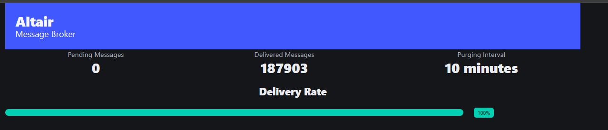

# Altair

A distributed asynchronous messaging platform developed in Go. Made only for study purposes.

## 🚀 About the Project

Altair is an asynchronous messaging system that allows sending and receiving messages through topics, with disk persistence and delivery via HTTP push consumers. Inspired by Apache Kafka, but with a simpler and more focused implementation.

## 🛠️ Technologies

- **Go** - Main language (strong in concurrency and performance)
- **Htmx** - Simple Dashboard
- **Append-only Log** - Data persistence
- **Distributed System** - Scalable architecture
- **HTTP Push** - Consumer delivery strategy

## 📋 Features

- 🔄 Message reception in topics
- 🔄 Disk persistence (append-only log)
- 🔄 HTTP push delivery to consumers
- 🔄 Partitioning
- 🔄 Replication and persistence
- 🔄 Offset tracking per consumer
- 🔄 HTTP push delivery
- 🔄 Backpressure

## 🏗️ Architecture

```
┌─────────────┐    ┌─────────────┐    ┌─────────────┐
│   Producer  │───▶│   Altair    │───▶│  Consumer   │
│             │    │   Broker    │    │   (HTTP)    │
└─────────────┘    └─────────────┘    └─────────────┘
                          │
                          ▼
                   ┌─────────────┐
                   │ Append-only │
                   │     Log     │
                   └─────────────┘
```

## 🚀 How to Run

```bash
# Run the project
make run

# Or directly with Go
go run ./main.go
```

## Accessing the Dashboard

Access the following Url:

`http://localhost:8080/`

### Dashboard Features

- Pending messages to be delivered
- Delivered Messages
- Current Purge interval
- Progress bar of delivered messages



## Performance Test

Performance tests run inside Docker so the broker gets a fixed resource budget and never competes with the load generator or the consumer for CPU. Only Docker (with Compose v2) is required on the host.

| Service | Role | Default limits |
|---------|------|----------------|
| `altair` | broker under test, data on named volumes (real disk, no bind mounts) | 2 CPU / 4 GB, no swap |
| `consumer` | any `examples/<name>` webhook receiver (default `01-consumer`) | 1 CPU / 512 MB, per-example via `perf.env` |
| `loader` | `autocannon` load generator | 2 CPU / 1 GB |

```bash
# Load against /publish with the example consumer registered (prints autocannon result,
# consumer received count + docker stats; no drain/verdict)
./perf/load.sh                       # or: make perf-load / .\perf\load.ps1

# End-to-end delivery validation (publish -> consumer webhook)
./perf/validate.sh smoke             # 500 requests, 01-consumer        (make perf-validate)
./perf/validate.sh heavy             # duration-based heavy load        (make perf-validate-heavy)
./perf/validate.sh heavy 02-foo      # a specific example               (make perf-validate EXAMPLE=02-foo)
./perf/validate.sh smoke all         # every example, then a summary    (make perf-validate EXAMPLE=all)
.\perf\validate.ps1 -Mode heavy -Example all
```

**Interactive mode** — watch the dashboard while the load runs. Only in this mode are the altair UI and the consumer's `/stats` published, and only on `127.0.0.1` (`ALTAIR_UI_PORT`, default `8080`; `CONSUMER_STATS_PORT`, default `9090`):

```bash
INTERACTIVE=1 ./perf/load.sh                # make perf-load-interactive [EXAMPLE=...]
.\perf\load.ps1 -Interactive
INTERACTIVE=1 ./perf/validate.sh heavy      # make perf-validate-interactive [EXAMPLE=...]
.\perf\validate.ps1 -Mode heavy -Interactive
```

1. The stack comes up and prints the URLs, then waits for Enter.
2. Enter fires a round (load, plus drain and verdict for `validate`). After each round, Enter fires another round on the same stack and `q` finishes. `validate` checks every round against cumulative totals, since the consumer counter and `deliveries/failed` accumulate.
3. Everything is cleaned up. Ctrl+C at any point, or EOF on stdin (e.g. CI), also finishes and cleans up instead of hanging. Not available with `all`.

Which examples can be validated and what counts as PASS for each (`perf.env`: origin, exact vs at-least delivery, expected `deliveries/failed`, drain timeout, limits) is defined by the contract in [examples/README.md](examples/README.md).

Tunables (env vars): `ALTAIR_CPUS`, `ALTAIR_MEM`, `LOADER_CPUS`, `LOADER_MEM`, `CONNECTIONS`, `DURATION`, `PIPELINING`, `REQUEST` (`smoke`|`heavy`, `load` only), `EXAMPLE` (`load`; default `01-consumer`), any `perf.env` key (overrides the example's file) and `KEEP=1` to leave the stack up after the run (single example only). Every run starts from fresh volumes.

Runs leave nothing behind: on exit (including failures and Ctrl+C) the scripts remove the stack's containers, network, volumes and images, plus a dedicated `altair-perf` buildx builder that holds all build cache and base images — so other projects' images and build cache are never touched. After `KEEP=1` or a killed run, `./perf/cleanup.sh` (`make perf-cleanup` / `.\perf\cleanup.ps1`) removes everything.

```bash
ALTAIR_CPUS=1 ALTAIR_MEM=1g DURATION=30 PIPELINING=20 ./perf/validate.sh heavy
```

### Reference run (bare metal, before the Docker setup)

Running 30s test @ http://localhost:8080/publish
20 connections with 20 pipelining factor

⏱️ Latency
<table> <tr><th>Stat</th><th>2.5%</th><th>50%</th><th>97.5%</th><th>99%</th><th>Avg</th><th>Stdev</th><th>Max</th></tr> <tr><td><b>Latency</b></td><td>19 ms</td><td>28 ms</td><td>100 ms</td><td>105 ms</td><td><b>38.25 ms</b></td><td>40.9 ms</td><td>1134 ms</td></tr> </table>

📈 Throughput
<table> <tr><th>Stat</th><th>1%</th><th>2.5%</th><th>50%</th><th>97.5%</th><th>Avg</th><th>Stdev</th><th>Min</th></tr> <tr><td><b>Req/Sec</b></td><td>1,224</td><td>1,224</td><td>13,343</td><td>16,119</td><td><b>10,315.5</b></td><td>5,103.26</td><td>1,224</td></tr> <tr><td><b>Bytes/Sec</b></td><td>474 kB</td><td>474 kB</td><td>5.16 MB</td><td>6.24 MB</td><td><b>3.99 MB</b></td><td>1.97 MB</td><td>474 kB</td></tr> </table>

Req/Bytes counts sampled once per second.
**of samples: 30**

310k requests in 30.04s, 120 MB read. Ryzen 5600x + RTX 3060

Transaction time, with 5s delay in consumer: 1m07s to process all messages.

## 🎯 Technical Challenges

### Partitioning

- Message distribution across multiple partitions
- Load balancing
- Message ordering by key

### Replication and Persistence

- Synchronization between replicas
- Data durability
- Failure recovery

### Offset Tracking

- Consumer read position control
- Offset persistence
- State recovery

### HTTP Push Delivery

- HTTP POST delivery to consumer endpoints
- Retry mechanisms for failed deliveries
- Consumer acknowledgment handling

### Backpressure

- Data flow control
- Overload prevention
- Throttling mechanisms

## 📁 Project Structure

---

**Altair** - Simplified Asynchronous Messaging 🚀
